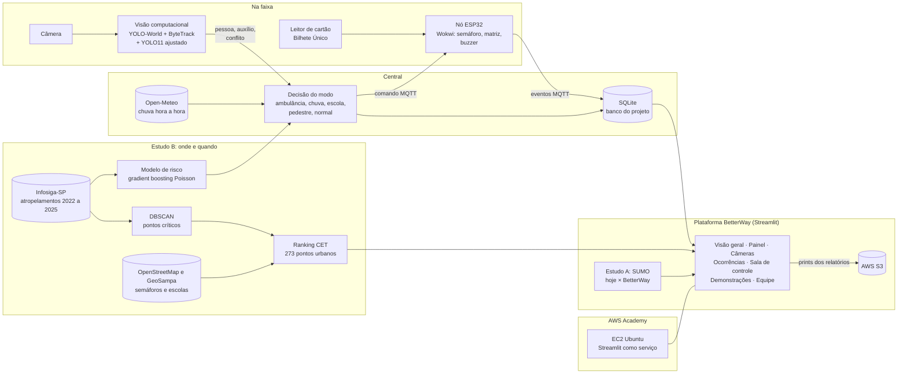

# FIAP - Faculdade de Informática e Administração Paulista

<p align="center">
<a href="https://www.fiap.com.br/">
  
</a>
</p>

<br>

# BetterWay: o semáforo que enxerga a faixa

**Global Solution 2026.2 · CitizenTech: tecnologia centrada no cidadão** · *To live, to move, to be free.*

## 👩‍🎓 Integrante

- <a href="https://br.linkedin.com/in/tamiresvferreiras">Tamires Vitória Ferreira dos Santos</a> (entrega individual)

## 👩‍🏫 Professores

### Tutor(a)
- <a href="#">Nome do Tutor</a>

### Coordenador(a)
- <a href="https://www.linkedin.com/in/andregodoichiovato/">André Godoi Chiovato</a>

## 📜 Descrição

Os semáforos de hoje funcionam no relógio: o tempo é o mesmo para todos, com ou sem gente na faixa. A **BetterWay**
dá olhos ao semáforo. Uma câmera entende a faixa de pedestres, uma central junta câmera, chuva, horário e o histórico
de atropelamentos do local, e um nó ligado ao semáforo ajusta o sinal na hora: espera quem ainda atravessa, libera a
via vazia e abre caminho para a ambulância. Uma plataforma web mostra tudo isso para as equipes de Trânsito, Saúde e
Gestão, que registram e acompanham as ocorrências.

O piloto é o **Largo da Concórdia, no Brás**: 53 atropelamentos entre 2022 e 2025, 2 com morte, numa avenida de seis
faixas com 16 m de travessia. A plataforma ordena **273 pontos críticos urbanos** de São Paulo.

**Resultados na simulação** (SUMO, cruzamento com as medidas do piloto, média de 5 rodadas de 30 min):

| Tudo ligado junto | Hoje | BetterWay |
|---|---|---|
| Pessoas na faixa com os carros da avenida em verde (por rodada) | 5,6 | **0** |
| Tempo da ambulância para passar o cruzamento | 49,3 s | **40,8 s (−17%)** |
| Espera de quem atravessa | 23,9 s | 23,6 s |
| Atraso médio de cada carro | 15,2 s | 16,4 s (+8%) |

Segurança primeiro: o semáforo só troca o verde depois de 4 s sem carro chegando, sempre com amarelo e vermelho total,
e nunca solta os carros com gente na faixa. O custo é de cerca de 1,2 s por carro.

ODS relacionados: 3, 9, 10, 11 e 13.

## 🏗️ Arquitetura



### As peças

| Peça | O que faz | Onde está |
|---|---|---|
| **Pontos críticos** | Agrupa os atropelamentos do Infosiga com DBSCAN (raio de 100 m), ordena pelo índice da CET (morte pesa 3) e cruza com semáforos e escolas. | `src/estudo_b_risco_vida/` (notebooks 01 a 04) |
| **Modelo de risco** | Estima onde e quando um atropelamento é provável (gradient boosting Poisson); a plataforma mostra o risco de agora contra a média da cidade. | `src/estudo_b_risco_vida/risco.py`, notebook 06 |
| **Visão computacional** | Detecta e rastreia pessoas e veículos, reconhece cadeira de rodas e andador, mede a travessia e o conflito com veículos, e borra rostos e placas antes de qualquer imagem aparecer. A ambulância é reconhecida por uma regra de cor (branco com faixa vermelha) sobre veículos grandes. | `src/visao/` |
| **Simulação (Estudo A)** | Cruzamento no SUMO com as medidas do piloto: semáforo de tempo fixo de hoje contra o semáforo que reage, com extensão para quem tem mobilidade reduzida, faixa vazia antes de liberar a avenida e prioridade para a ambulância. | `src/simulacao/` |
| **Central** | Decide o modo do semáforo (ambulância > chuva > escola > pedestre > normal), pede tempo extra quando a câmera vê alguém com auxílio de mobilidade e fala com o nó por MQTT. | `src/central/` |
| **Nó ESP32** | Semáforo de carros e pedestre, matriz de LED como placa, buzzer e leitor de cartão (Bilhete Único Idoso ou Especial, como o Green Man+ de Singapura). Recebe o modo e decide sozinho o ciclo; quem já atravessa nunca é cortado. | `src/esp32/` (Wokwi) |
| **Plataforma** | Login com convite e código de aplicativo (TOTP), perfis Trânsito, Saúde e Gestão, câmeras com registro de ocorrência e print do momento, sala de controle, central de demonstrações (cartão e alerta no celular), leitura em voz e tema claro ou escuro. | `src/operador/` |
| **Banco** | SQLite com atropelamentos, pontos críticos, eventos do nó, ocorrências e histórico, relatórios e prints, leituras de cartão, usuários (senha em hash scrypt) e acessos às câmeras. | `data/processed/seguranca_viaria.db` (fora do Git) |
| **AWS** | Bucket S3 privado com o pacote da plataforma e a cópia dos prints dos relatórios; instância EC2 que roda a plataforma, com a função do laboratório (sem chaves dentro do servidor). | `deploy/aws/` |

### Privacidade e rastreabilidade

* Nenhum rosto é reconhecido: rostos e placas saem borrados antes de qualquer imagem ser mostrada.
* O cartão registra só o tipo (Idoso ou Especial), o horário e o tempo extra. Nenhum número nem nome.
* Cada ação guarda quem fez e quando: abrir uma câmera, registrar e enviar um relatório, confirmar, descartar,
  despachar e encerrar uma ocorrência.
* Senhas só em hash (scrypt), convite de uso único e segundo fator por aplicativo autenticador.

## 📁 Estrutura de pastas

* **`src/estudo_b_risco_vida/`** limpeza do Infosiga, pontos críticos (DBSCAN) e modelos de risco.
* **`src/visao/`** detecção, rastreamento, travessia, auxílios de mobilidade e borrão; processamento dos clipes.
* **`src/simulacao/`** Estudo A no SUMO e exportação das cenas da plataforma.
* **`src/central/`** decisão do modo, fontes (chuva, escola, visão), contrato MQTT e roteiro de demonstração.
* **`src/esp32/`** firmware do nó para o Wokwi.
* **`src/operador/`** a plataforma BetterWay (Streamlit).
* **`deploy/aws/`** implantação no AWS Academy (S3 e EC2).
* **`docs/`** especificações, planos, roteiro da demonstração e `evidencias/` (métricas, cenas, avaliações).
* **`tests/`** 331 testes rápidos e 13 lentos (SUMO e modelos).

## 🔧 Como executar o código

**Local** (a partir de `1TIAO/GLOBAL-SOLUTION-2`):

```bash
python -m venv ../../.venv
../../.venv/Scripts/activate                     # Linux e macOS: source ../../.venv/bin/activate
pip install -r requirements.txt
python src/operador/autenticacao.py convidar email@exemplo.org gestao "Nome da pessoa"   # primeiro acesso
streamlit run src/operador/app.py --server.port 8611
python -m pytest tests -m "not slow"             # testes rápidos
```

**Nó ESP32 no Wokwi:** ver `src/esp32/README.md` e o roteiro `docs/roteiro_demonstracao_esp32.md`. Sem o Wokwi, a
Sala de controle tem um plano B que simula os sinais do nó.

**AWS Academy:** com as credenciais do Learner Lab em `~/.aws/credentials`, `python deploy/aws/implantar.py` cria o
bucket, sobe o pacote e lança a instância; `--status` mostra o endereço e `--encerrar` desliga a instância.

## 📎 Links e Observações

### 🔗 Links do Projeto

* **Vídeo de entrega (YouTube, não listado):** a incluir.

### 📢 Observações Gerais

* **Participação na Competição:** [x] Sim, aceito participar / [ ] Não vou participar.
* Simulação, câmeras da rede (exceto a do piloto), ambulância despachada, cartão e alerta no celular são
  demonstrações e estão marcados como simulados na plataforma. Os vídeos das câmeras são clipes de referência
  gerados por IA (Veo 3) e vídeos públicos do Pexels.
* Limites conhecidos: a visão ainda não reconhece bengala nem muleta (quem usa tem o cartão); o nó roda no Wokwi,
  não em hardware; o broker MQTT é público, só para a demonstração.

---

## 📋 Licença

<p xmlns:cc="http://creativecommons.org/ns#" xmlns:dct="http://purl.org/dc/terms/"><a property="dct:title" rel="cc:attributionURL" href="https://github.com/fiap-tutoria/FIAP-PORTFOLIO-AI">TEMPLATE - FIAP PORTFÓLIO AI</a> por <a rel="cc:attributionURL dct:creator" property="cc:attributionName" href="https://fiap.com.br">FIAP</a> está licenciado sobre <a href="http://creativecommons.org/licenses/by/4.0/?ref=chooser-v1" target="_blank" rel="license noopener noreferrer" style="display:inline-block;">Attribution 4.0 International</a>.</p>
