<p align="center">
  <picture>
    <source media="(prefers-color-scheme: dark)" srcset="assets/marca/betterway-logo-horizontal-escuro.png">
    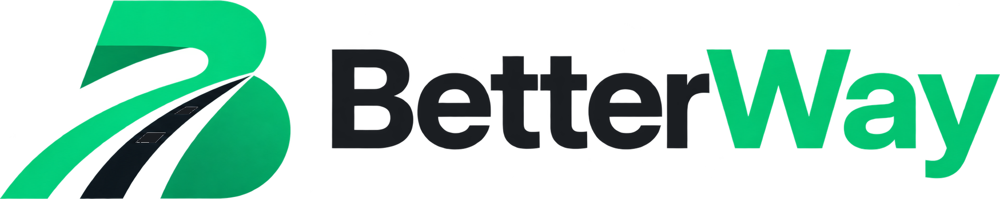
  </picture>
</p>

<h3 align="center">O semáforo que enxerga a faixa</h3>

<p align="center"><i>To live, to move, to be free.</i></p>

<p align="center">
  
  
  
  
  
  
  
  
</p>

<p align="center">
  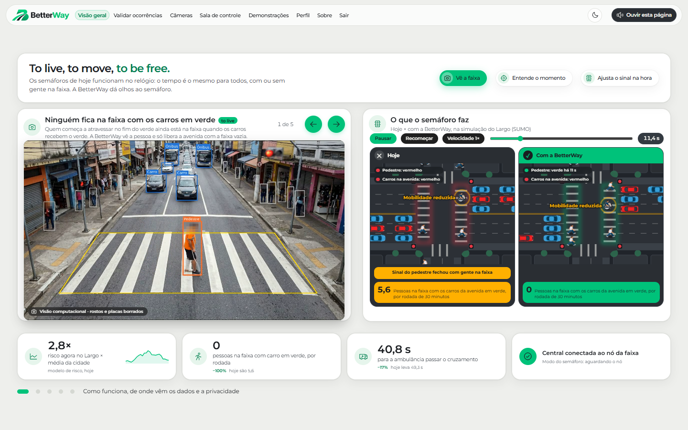
</p>

Os semáforos de hoje funcionam no relógio: o tempo é o mesmo para todos, com ou sem gente na faixa. A **BetterWay** dá
olhos ao semáforo. Uma câmera entende a faixa de pedestres, uma central junta câmera, chuva, horário e o histórico de
atropelamentos do local, e um nó ligado ao semáforo ajusta o sinal na hora: espera quem ainda atravessa, libera a via
vazia e abre caminho para a ambulância. Uma plataforma web mostra tudo isso para as equipes de Trânsito, Saúde e Gestão.

> Projeto individual criado na **Global Solution 2026.2 da FIAP** (Graduação em Inteligência Artificial, tema
> *CitizenTech: tecnologia centrada no cidadão*) e mantido aqui como portfólio. Do dado bruto ao hardware, passando por
> modelos, visão computacional, simulação e interface, tudo foi feito por mim.

## Sumário

* [Resultados](#resultados)
* [Demonstrações](#demonstrações)
* [Arquitetura](#arquitetura)
* [O que eu construí](#o-que-eu-construí)
* [Competências aplicadas](#competências-aplicadas)
* [Privacidade e LGPD](#privacidade-e-lgpd)
* [Como executar](#como-executar)
* [Limites e próximos passos](#limites-e-próximos-passos)
* [Fontes e créditos](#fontes-e-créditos)

## Resultados

O piloto é o **Largo da Concórdia, no Brás (São Paulo)**: 53 atropelamentos entre 2022 e 2025, 2 com morte, numa avenida
de seis faixas com 16 m de travessia. A partir de **dados abertos do Infosiga-SP**, o projeto encontrou e ordenou
**273 pontos críticos urbanos** de atropelamento na cidade.

Na simulação (SUMO, cruzamento com as medidas do piloto, média de 5 rodadas de 30 min):

| Tudo ligado junto | Semáforo de hoje | BetterWay |
|---|---|---|
| Pessoas na faixa com os carros da avenida em verde (por rodada) | 5,6 | **0** |
| Tempo da ambulância para passar o cruzamento | 49,3 s | **40,8 s (−17%)** |
| Espera de quem atravessa | 23,9 s | 23,6 s |
| Atraso médio de cada carro | 15,2 s | 16,4 s (+8%) |

Segurança primeiro: o semáforo só troca o verde depois de 4 s sem carro chegando, sempre com amarelo e vermelho total,
e nunca solta os carros com gente na faixa. O custo é de cerca de 1,2 s por carro.

## Demonstrações

### Visão computacional na faixa

A câmera detecta e rastreia pessoas e veículos, mede a travessia e o conflito com os carros e borra rostos e placas
antes de qualquer imagem aparecer.

<p align="center">
  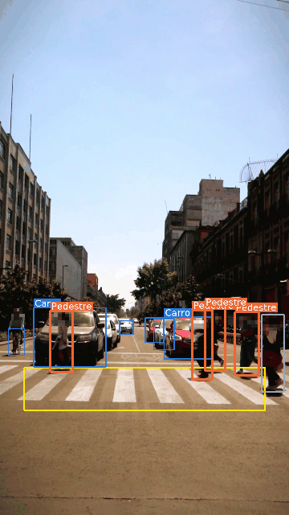
  &nbsp;
  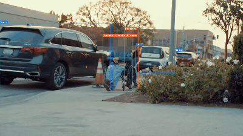
</p>
<p align="center"><sub>À esquerda, travessias medidas em vídeo público (Pexels). À direita, o YOLO11 que ajustei reconhece a
pessoa em cadeira de rodas em 87% dos quadros.</sub></p>

### Simulação do cruzamento: hoje × BetterWay

<p align="center">
  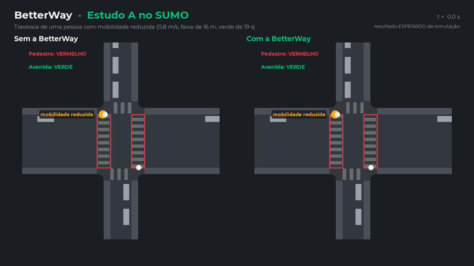
  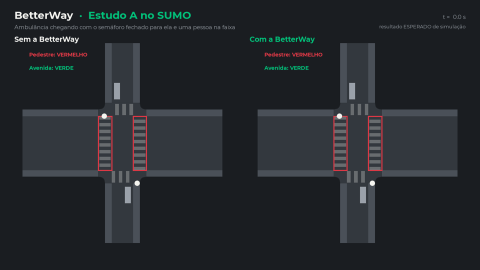
</p>
<p align="center"><sub>Pedestre com mobilidade reduzida (esquerda) e prioridade para a ambulância (direita), rodados no SUMO.</sub></p>

### Plataforma

| | |
|---|---|
| 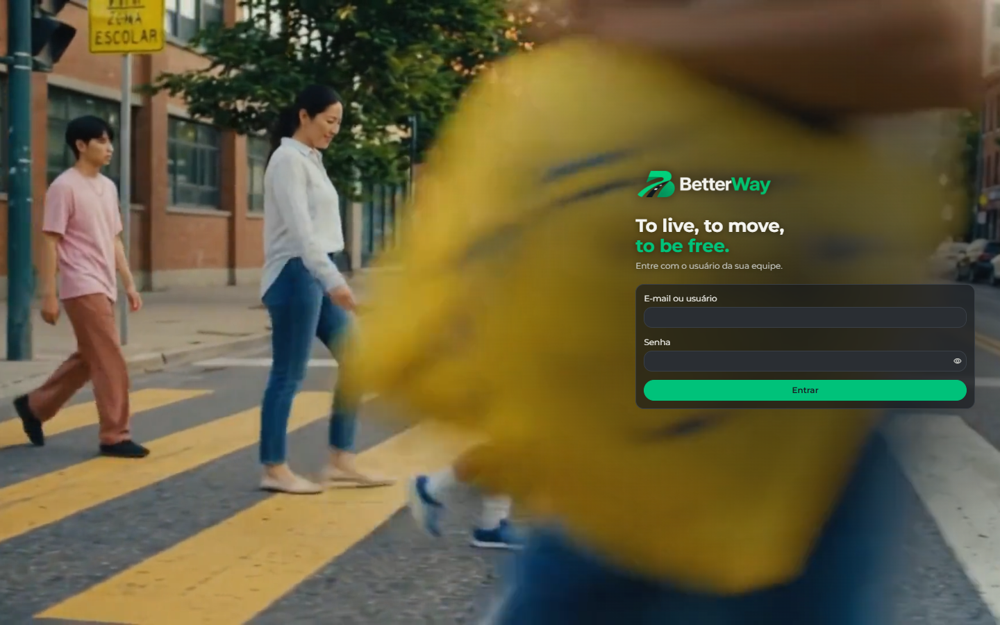 <br><sub>**Login** com convite e segundo fator por aplicativo autenticador (TOTP).</sub> | 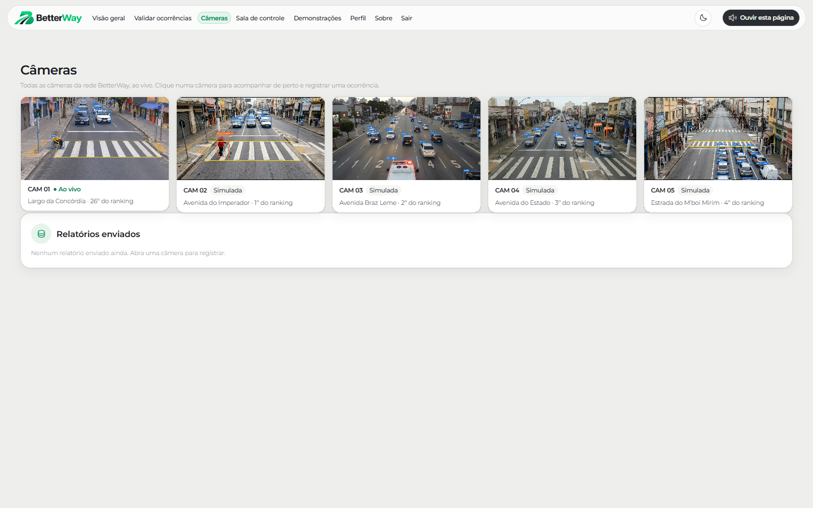 <br><sub>**Câmeras** da rede nos pontos críticos do ranking, já com a visão computacional.</sub> |
| 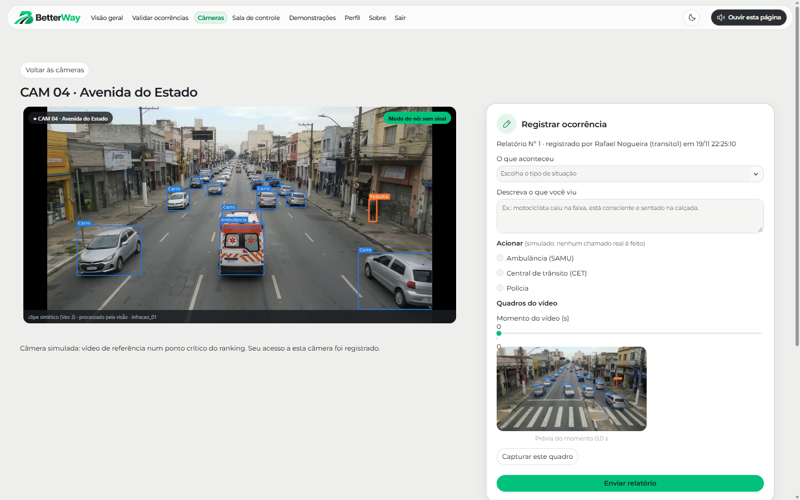 <br><sub>**Câmera aberta**: a equipe registra a ocorrência com o quadro do momento e aciona SAMU, CET ou polícia (simulado).</sub> | 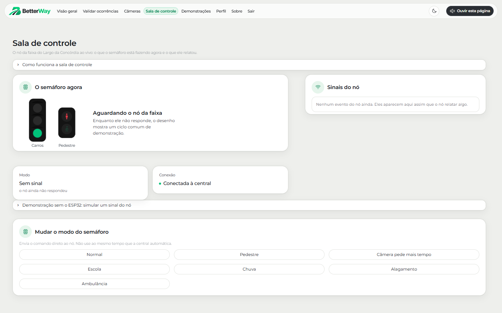 <br><sub>**Sala de controle**: o que o semáforo faz agora e os sinais que o nó relata por MQTT.</sub> |
| 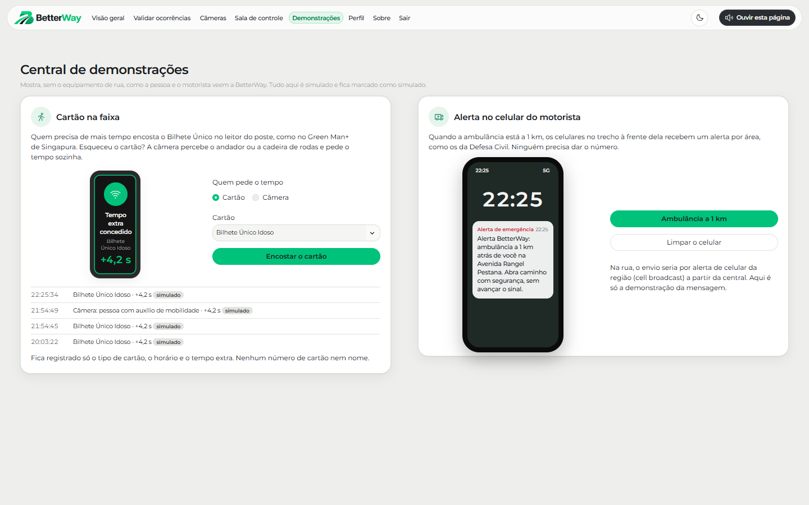 <br><sub>**Demonstrações**: tempo extra pelo Bilhete Único e alerta no celular de quem está no caminho da ambulância.</sub> | 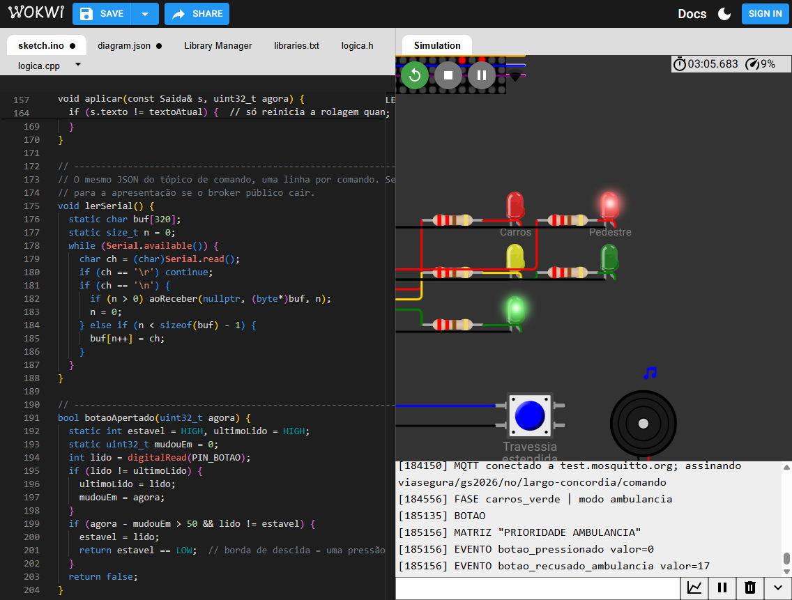 <br><sub>**Nó ESP32** no Wokwi: com a ambulância chegando, o pedido de travessia espera e é atendido logo depois.</sub> |

O nó pode ser aberto e executado no navegador: [projeto no Wokwi](https://wokwi.com/projects/480902516851985409).

## Arquitetura

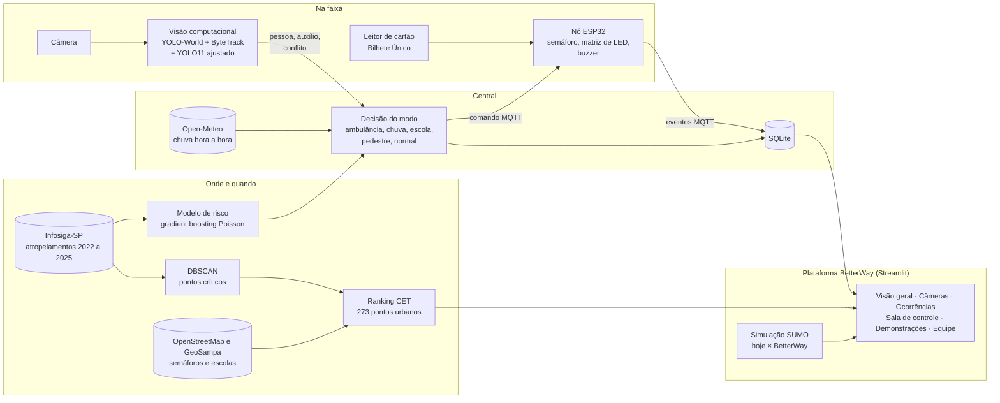

Um relatório técnico de 12 páginas, com método, números e limites, está em
[docs/BetterWay_GS2026-2.pdf](docs/BetterWay_GS2026-2.pdf).

## O que eu construí

| Peça | O que faz | Onde está |
|---|---|---|
| **Pontos críticos** | Limpa e cruza os atropelamentos do Infosiga, agrupa com DBSCAN (raio de 100 m, morte com peso 3), ordena pelo índice de concentração da CET e cruza com semáforos e escolas. | [src/estudo_b_risco_vida](src/estudo_b_risco_vida) (notebooks 01 a 04) |
| **Modelo de risco** | Estima onde e quando um atropelamento é provável (gradient boosting com perda Poisson, por célula de ~500 m × hora × tipo de dia × chuva) e compara o risco de agora com a média da cidade. | [risco.py](src/estudo_b_risco_vida/risco.py), notebook 06 |
| **Visão computacional** | Detecta e rastreia pessoas e veículos (YOLO-World + ByteTrack), mede tempo de travessia e conflito veículo × pedestre, reconhece cadeira de rodas e andador com um YOLO11 que ajustei no Colab e borra rostos (pela pose) e placas. | [src/visao](src/visao) |
| **Simulação** | Cruzamento no SUMO calibrado pelo piloto: semáforo de tempo fixo contra o semáforo que reage, com extensão para mobilidade reduzida, faixa vazia antes de liberar a avenida e prioridade para a ambulância. | [src/simulacao](src/simulacao) |
| **Central** | Decide o modo do semáforo (ambulância > chuva > escola > pedestre > normal), pede tempo extra quando a câmera vê alguém com auxílio de mobilidade e fala com o nó por MQTT. | [src/central](src/central) |
| **Nó ESP32** | Firmware em C++ com a lógica separada do hardware: semáforos de carros e pedestre, matriz de LED, buzzer e leitor de cartão (como o Green Man+ de Singapura). Quem já atravessa nunca é cortado. | [src/esp32](src/esp32) |
| **Plataforma** | Login com convite e TOTP, perfis Trânsito, Saúde e Gestão, câmeras com registro de ocorrência, sala de controle, demonstrações, leitura em voz e tema claro ou escuro. | [src/operador](src/operador) |

O desenvolvimento seguiu especificação, plano e testes para cada módulo ([docs/specs](docs/specs), [docs/plans](docs/plans)),
com evidências versionadas em [docs/evidencias](docs/evidencias) e **331 testes rápidos e 13 lentos** em [tests](tests).

## Competências aplicadas

* **Ciência de dados:** limpeza e conferência de uma base pública grande (Infosiga), análise exploratória, dados
  georreferenciados (GeoPandas, Folium, OpenStreetMap via Overpass, GeoSampa WFS).
* **Machine learning:** clusterização espacial (DBSCAN com haversine), regressão logística, árvores e random forest,
  gradient boosting com perda Poisson, validação temporal e calibração; e a decisão de trocar o alvo quando o primeiro
  classificador ficou fraco (ROC 0,62).
* **Visão computacional:** detecção de vocabulário aberto (YOLO-World), rastreamento (ByteTrack), ajuste fino de
  YOLO11 no Google Colab, estimativa de pose para anonimização, avaliação em conjunto separado e por vídeo.
* **Simulação:** SUMO e TraCI, controle de semáforo atuado, cenários comparáveis com várias sementes.
* **IoT e sistemas embarcados:** ESP32 em C++, máquina de estados, MQTT, simulação no Wokwi.
* **Back-end e integração:** Python, SQLite, contrato de mensagens MQTT, APIs de dados abertos (Open-Meteo).
* **Front-end e UX:** Streamlit com componentes HTML e CSS próprios, design system com tokens, responsivo, tema claro e
  escuro, acessibilidade (leitura em voz).
* **Segurança e privacidade:** hash scrypt, convite de uso único, TOTP, bloqueio por tentativas, registro de acesso,
  anonimização de imagens e minimização de dados (LGPD).
* **Engenharia de software:** testes automatizados (pytest), especificações e planos por módulo, Git com branches e PRs.
* **Comunicação:** relatório técnico, README com arquitetura e demonstrações pensadas para quem não é da área.

## Privacidade e LGPD

* Nenhum rosto é reconhecido: rostos e placas saem borrados antes de qualquer imagem ser mostrada.
* A visão etiqueta o **auxílio visível** (cadeira de rodas, andador), nunca a aparência da pessoa.
* O cartão registra só o tipo (Idoso ou Especial), o horário e o tempo extra. Nenhum número nem nome.
* O alerta da ambulância seria enviado por área (cell broadcast), sem saber número nem identidade de ninguém.
* Cada ação guarda quem fez e quando: abrir uma câmera, registrar, confirmar, despachar e encerrar uma ocorrência.

## Como executar

```bash
python -m venv .venv
.venv/Scripts/activate                  # Linux e macOS: source .venv/bin/activate
pip install -r requirements.txt
python src/operador/autenticacao.py convidar email@exemplo.org gestao "Nome da pessoa"   # primeiro acesso
streamlit run src/operador/app.py
python -m pytest tests -m "not slow"    # testes rápidos
```

Os dados brutos do Infosiga não vão para o Git por tamanho; [data/README.md](data/README.md) explica como baixar e os
notebooks regeneram o banco. Para o nó, veja [src/esp32/README.md](src/esp32/README.md) e o
[roteiro de demonstração](docs/roteiro_demonstracao_esp32.md). Sem o Wokwi, a Sala de controle simula os sinais do nó.

### Estrutura

```
src/estudo_b_risco_vida/   dados do Infosiga, pontos críticos (DBSCAN) e modelos de risco
src/visao/                 detecção, rastreamento, travessia, auxílios de mobilidade e borrão
src/simulacao/             cruzamento no SUMO e cenas da plataforma
src/central/               decisão do modo, fontes de dados e contrato MQTT
src/esp32/                 firmware do nó (Wokwi)
src/operador/              plataforma BetterWay (Streamlit)
docs/                      relatório, especificações, planos e evidências
tests/                     testes automatizados
```

## Limites e próximos passos

* Os ganhos no trânsito são resultados de simulação, não de campo.
* Só o piloto tem câmera de verdade no projeto; as outras câmeras da rede usam clipes de referência gerados por IA
  (Veo 3) e vídeos públicos do Pexels, sempre marcados como simulados.
* A visão ainda não reconhece bengala nem muleta (quem usa tem o cartão).
* O nó roda no Wokwi, não em hardware; o broker MQTT é público, só para demonstração.
* Não há integração real com CET ou SAMU: despacho, cartão e alerta no celular são simulados.

## Fontes e créditos

* Atropelamentos: [Infosiga-SP](https://infosiga.detran.sp.gov.br) (Detran-SP), dados abertos.
* Semáforos e escolas: © colaboradores do [OpenStreetMap](https://www.openstreetmap.org/copyright) (ODbL) e
  [GeoSampa](https://geosampa.prefeitura.sp.gov.br) (Prefeitura de São Paulo).
* Chuva: [Open-Meteo](https://open-meteo.com).
* Vídeos de teste: [Pexels](https://www.pexels.com/license/) (autores creditados em [data/raw/video/FONTE.md](data/raw/video/FONTE.md)).
* Ajuste fino: dataset *wheelchair-tmzbn* do Roboflow Universe (CC BY 4.0), detalhes em [data/treino_pcd/FONTE.md](data/treino_pcd/FONTE.md).
* Fonte Montserrat (SIL Open Font License).

---

<p align="center">
  Feito por <a href="https://br.linkedin.com/in/tamiresvferreiras"><b>Tamires Vitória Ferreira dos Santos</b></a> ·
  <a href="https://github.com/tamiresvferreira">outros projetos</a>
</p>
